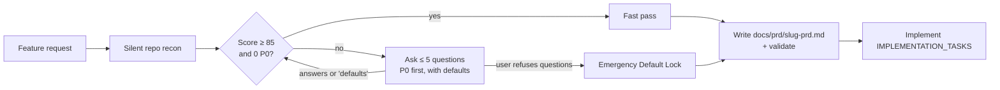

# Where's My PRD

**Never let an agent code a half-baked PRD again.**

[](https://github.com/Rupam-Shil/where-is-my-prd/actions/workflows/ci.yml)
[](LICENSE)


Give a coding agent a two-line prompt and it will invent your database schema, skip rate limits, ignore empty states, and ship a referral system anyone can farm with throwaway emails. It will do all of this confidently, without asking.

**Where's My PRD** is an open-source agent skill that puts a hard gate in front of your agent's first edit. It scores the request across five dimensions, asks at most five sharp questions with a recommended default for each, and writes a locked, machine-checkable PRD before any application code exists. Answering takes one reply. A good spec passes in zero questions.

```text
> add a referral system — users get a referral link, and when a friend signs up both get $10 credit. ship it today pls

Spec Readiness: 32/100 — BLOCKED
State 10/20 · Data 6/20 · Abuse 4/20 · Telemetry 6/20 · Rollout 6/20
Repo: Next.js 15 · Prisma/Postgres · NextAuth v5 (Google only) · Stripe · Upstash ratelimit · PostHog

1. [P0 BLOCKER] What unit is `User.credits`, and what is "$10"?
   Why it matters: Guess wrong and every referral grants 10x or 1000x the intended amount.
   A) Integer cents + an append-only CreditLedger; credits becomes a cached balance [Recommended Default]
   B) 1 credit = $1, so the grant is 10, with no ledger

2. [P0 BLOCKER] When is the $10 granted, and what stops farming? …
3. [P0 BLOCKER] How is a referral attributed across the OAuth redirect, and kept from paying twice? …
4. [P0 BLOCKER] What is the kill switch, and what if it flips off? …

Reply like `1A 2B 3A 4A`, or `defaults` to accept every recommendation.

> use your recommended defaults, except cap referral rewards at 5 per referrer per month

Spec: docs/prd/referral-system-prd.md passes the validator (86/100, 0 P0 left).
Built: ledger + Referral models (additive), /r/[code] cookie link, grant in events.createUser
with alias normalization, a row lock for the 5/month cap, one transaction, fail-closed kill switch.
```

<sub>Real output from eval scenario `01-referral-urgency` (Claude Sonnet in Claude Code), trimmed. The full transcript is in [`examples/full-grill-referral-system.md`](examples/full-grill-referral-system.md).</sub>

## Same prompt, same model, same repo

| | Without the skill | With Where's My PRD |
|---|---|---|
| Questions before writing code | 0 | 4 P0s, answered in one reply |
| App files changed before a spec existed | 4, including `prisma/schema.prisma` | **0** (the eval checks every write in order) |
| Decisions made without asking the user | 9 | 0 left implicit: every one is written in the PRD |
| $10 signup reward farmable with throwaway emails | Yes | No: verified email, alias normalization, 5/month cap |
| Exactly-once crediting | No | Append-only ledger, unique keys, one transaction |
| Output | Code built on guesses | [A locked PRD](examples/prd/referral-system-prd.md) (86/100), then the build |

## Install

**Any agent** (Claude Code, Cursor, Codex, OpenCode, and [more](https://skills.sh)), via the open skills CLI:

```bash
npx skills add Rupam-Shil/where-is-my-prd
```

**Claude Code plugin:**

```text
/plugin marketplace add Rupam-Shil/where-is-my-prd
/plugin install wheres-my-prd@wheres-my-prd
```

<details>
<summary><b>Manual install</b></summary>

```bash
git clone https://github.com/Rupam-Shil/where-is-my-prd.git

# Claude Code (all projects)
cp -r where-is-my-prd/skills/wheres-my-prd ~/.claude/skills/

# Codex (all projects; use .agents/skills/ inside a repo for one project)
cp -r where-is-my-prd/skills/wheres-my-prd ~/.agents/skills/

# Cursor (all projects; use .cursor/skills/ inside a repo for one project)
cp -r where-is-my-prd/skills/wheres-my-prd ~/.cursor/skills/

# Cursor without skills support: use the generated rule instead
cp where-is-my-prd/.cursor/rules/wheres-my-prd.mdc your-project/.cursor/rules/
```

</details>

**Using it:** the skill activates on its own when you ask for a new feature. You can also invoke it explicitly:

| Agent | Explicit invocation |
|---|---|
| Claude Code (skill) | `/wheres-my-prd` |
| Claude Code (plugin) | `/wheres-my-prd:wheres-my-prd` or `/wheres-my-prd:grill-prd <idea>` |
| Cursor | `/wheres-my-prd` |
| Codex | `$wheres-my-prd` |

Or just say "where's my prd", "grill my spec", or "stress-test this PRD".

### Suggested first task

Open your agent in any real repo and paste:

> add a referral system — users get a referral link, and when a friend signs up both of them get $10 credit

Then compare what you get with what your agent would have built without the skill.

## How it works



1. **Recon.** Before asking anything, it reads your manifest, schema, routes, auth, and flag/analytics/rate-limit libraries. It never asks what your repo already answers.
2. **Score.** It rates the request 0–20 on each of the five dimensions below and tags every gap **P0** (a wrong guess means lost money, lost data, a security hole, or an outage) or **P1** (a design choice with a safe default).
3. **Interrogate.** It asks at most 5 questions per round, P0s first. Each one says *why it matters* and offers concrete options with one `[Recommended Default]`. You can reply in shorthand: `1A 2B 3: cap at 5`, or `defaults`. It runs at most two rounds.
4. **Lock and hand off.** It writes `docs/prd/<feature-slug>-prd.md` and validates it. Then:
   - **You answered its questions:** it starts building, task by task. Your answers were the go-ahead.
   - **Fast pass:** it shows the assumptions it made and asks before building.
   - **You only asked for a review or a PRD:** it stops at the PRD.

### The five dimensions

| Dimension | What it catches | Example P0 |
|---|---|---|
| **State machine & edge cases** | Empty/loading/error/rate-limited states, double-submit, cancel mid-flow, 0 vs 10,000 items | "User closes the modal while the webhook is pending: duplicate submission on reopen?" |
| **Data contracts & schema safety** | Units, nullability, unsafe migrations, idempotency keys, backward compatibility | "`NOT NULL` column on a populated `users` table will fail in production" |
| **Abuse, security & failure modes** | AuthZ/tenant isolation, farming, rate limits, third-party downtime, PII in logs | "Can a user redeem their own referral with a second email?" |
| **Telemetry & success metrics** | KPI definition, server-side events, alert thresholds | "Which events prove this worked, and what number means success?" |
| **Rollout, flags & rollback** | Feature flags, kill switches, reversible migrations, launch prerequisites | "If we flip it off after 1,000 users, what happens to their credits?" |

**Domain packs** add sharper questions for high-risk work: **Payments & Escrow**, **Fintech & Regulated**, **AI / LLM features** (prompt injection, cost caps), **Real-time / sockets**, **Multi-tenant SaaS**, and **Mobile**. See [`domain-packs.md`](skills/wheres-my-prd/references/domain-packs.md).

### The hard gate

While `p0_blockers_remaining > 0`, the agent may not create, edit, or stub application source, schemas, migrations, or config. The only file it may write is the PRD.

- **"Ship it today"** is urgency, not a refusal. The agent still asks, keeps the round to the P0s, and you can answer `defaults`.
- **"No questions, just build it"** triggers the **Emergency Default Lock**. In one turn, the agent lists every assumption, writes the PRD first, and then codes. The validator flags the spec as never confirmed, so reviewers can see it. Nothing is assumed silently. See [`examples/emergency-lock-usage-billing.md`](examples/emergency-lock-usage-billing.md).
- **A complete spec** fast-passes with zero questions. See [`examples/fast-pass-feedback-widget.md`](examples/fast-pass-feedback-widget.md).

### Phase 2, v2, and existing projects

Ask for "referrals phase 2" or "billing v2", and the skill treats what already shipped as the baseline.

- **If the feature has a PRD,** it reads that PRD and the code that shipped, and flags any drift between them. It then asks only about the change: existing data, whether new rules are retroactive, compatibility, and rolling back to v1. Decisions that still hold aren't asked again.
- **If the feature shipped without a PRD** (an existing project), it builds the baseline from the code instead.
- **Either way, it writes a new PRD.** For example: `docs/prd/referral-system-v2-prd.md`, with `phase: 2`, `parent_prd`, and a Baseline & Changes section. The v1 PRD is never rewritten, because it's the record of what shipped.
- **A copy tweak or bug fix** on a shipped feature doesn't trigger the skill.

See a real run: [`examples/phase-2-referrals.md`](examples/phase-2-referrals.md).

## Tested against real Claude Code

The skill runs against [23 scenarios](evals/) in headless Claude Code. The agent is free to write files, and the harness checks the order of every write. The scenarios include pressure tests:

- an authority figure saying "don't overthink it"
- a 1am investor-demo panic
- "scaffold the obvious parts while I think"
- "stop asking questions, just build it"

| Model | Gate held (no code before a locked PRD) | Skill triggered on its own | Right mode | Every question well-formed |
|---|---|---|---|---|
| Claude Sonnet | **18/18** | **18/18** (and 0/2 false triggers) | **18/18** | **40/40** |
| Claude Opus | **8/8** | **8/8** | **8/8** | **8/8** |
| Claude Haiku | 15/18 | 15/18 | 13/18 | 12/16 |

Follow-up phases (phase 2 on a shipped feature, with or without an earlier PRD) pass on every model: Sonnet 6/6, Opus 3/3, Haiku 3/3.

Testing found and fixed seven real problems before launch. One example: "DO NOT ask me questions" used to make Claude skip the skill entirely, so the agent wrote code with no PRD. [`evals/`](evals/) has the full story, the raw runs, and `python3 evals/run.py` to reproduce them.

## The output: a PRD your agent can execute in one shot

Every PRD starts with machine-readable frontmatter, so downstream skills and CI can verify that the gate passed:

```yaml
---
feature_slug: referral-system
spec_readiness_score: 88          # must be >= 85 to unlock coding
p0_blockers_remaining: 0          # must be 0 to unlock coding
interrogation_mode: full_grill    # full_grill | fast_pass | emergency_default_lock
approved_at: 2026-10-26T19:47:12Z
phase: 1                          # 2, 3, … for follow-up phases
parent_prd: none                  # phase 2+: the previous phase's PRD, or none
---
```

The PRD then has these sections: Overview · User Flow & State Machine (Idle, Loading, Success, Empty, Error, Rate-Limited) · Data Contracts & Schema Changes · Edge Cases, Abuse Vectors & Guardrails · Telemetry & Event Logging · Rollout, Flags & Rollback · Non-Goals · Open Risks & Assumed Defaults · Acceptance Criteria · `IMPLEMENTATION_TASKS`.

Each task cites the acceptance criteria it satisfies, so the PRD plugs straight into plan-execution skills such as [obra/superpowers](https://github.com/obra/superpowers)' `writing-plans` and `executing-plans`. Where's My PRD decides **what** to build; execution skills handle **how**.

Real examples: [`examples/prd/`](examples/prd/).

## Enforce it in CI

Fail any PR that doesn't link a locked PRD:

```yaml
# .github/workflows/prd-gate.yml
name: prd-gate
on: pull_request
jobs:
  prd:
    runs-on: ubuntu-latest
    steps:
      - uses: actions/checkout@v5
      - uses: Rupam-Shil/where-is-my-prd@v1
        with:
          require-pr-link: true   # PR description must reference docs/prd/<slug>-prd.md
```

Or run the zero-dependency POSIX validator directly:

```bash
sh skills/wheres-my-prd/scripts/validate-prd.sh docs/prd
# PASS docs/prd/referral-system-prd.md (score 88/100, full_grill)
# FAIL docs/prd/checkout-v2-prd.md
#   - p0_blockers_remaining is 2 (must be 0 before any code is written)
```

## FAQ

**Won't this slow me down?** A complete spec passes in zero questions. An incomplete one gets at most 5 questions, and `defaults` answers all of them. A round takes seconds to answer. Skipping it is how you end up unwinding a dozen files after discovering the missing requirement.

**What if I don't know an answer?** Say "not sure" or "skip". The agent locks the recommended default as an *Assumed Default* (or logs an *Open Discovery Risk* when no safe default exists) and moves on. It never loops.

**Will it fire on every small change?** No. Bug fixes with repro steps, copy tweaks, formatting, dependency bumps, and read-only questions are explicitly excluded.

**How much context does it use?** `SKILL.md` is under 1,800 tokens. The rubric, domain packs, and template load only when they're needed.

**Which models does it work with?** Claude Sonnet and Opus pick it up on their own and held the gate in every eval run. Smaller models such as Haiku trigger it less reliably, so invoke it explicitly there (`/wheres-my-prd`). See [`evals/`](evals/).

**Does it work without a repo?** Yes. Recon is skipped, and on chat-only surfaces the PRD is printed inline.

## Repository layout

```text
where-is-my-prd/
├── .claude-plugin/             # Claude Code plugin + marketplace manifests
├── .cursor/rules/              # Generated Cursor rule (fallback for rule-based setups)
├── commands/grill-prd.md       # /wheres-my-prd:grill-prd for the Claude Code plugin
├── skills/wheres-my-prd/
│   ├── SKILL.md                # The skill (<1,800 tokens)
│   ├── references/             # Rubric, domain packs, PRD template (loaded on demand)
│   └── scripts/validate-prd.sh # Zero-dependency PRD linter
├── examples/                   # Real transcripts (all three modes + a phase 2) and their PRDs
├── evals/                      # 23 scenarios run against real headless Claude Code, results
├── action.yml                  # GitHub Action: uses: Rupam-Shil/where-is-my-prd@v1
└── tests/run.sh                # Validator + repo tests (sh, dash, bash, ksh)
```

## Contributing

Bug reports and new domain packs are welcome, and so are eval runs on models and agents we haven't tested. See [CONTRIBUTING.md](CONTRIBUTING.md). Run `sh tests/run.sh` before opening a PR.

## License

[MIT](LICENSE) © Rupam Shil
